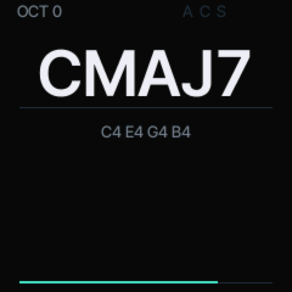

# Hingebox firmware (a fork of DUMBMIDI)

The SMK-37 (Pro, Elite, MKE-P37) and FM-1 firmware that [Hingebox](https://github.com/ShowboatStudios/hingebox)
offers to install: a fork of [konsumer/dumbmidi](https://github.com/konsumer/dumbmidi) (GPL-3.0, all credit for
the firmware to konsumer and the FOMA platform), with these changes:

- Pad colours a host streams on channel 16 live in RAM only: Hingebox lights the pads with its step grid and a
  running playhead, which in DUMBMIDI rewrote the saved settings (flash) every time the stream paused. CC 17 = 0
  hands the pads back to the saved colours.
- Pads send on channel 10 out of the box (notes 36-51), so they never collide with the keys (from 48, channel 1).
- Named HINGEBOX; packages `hingebox-smk37[-elite|-mke]-<version>.fwsc`.

Flashing is at your own risk: back up the unit's flash first (see below and genkigenki/fm1-to-smk37 docs/02).

---

# DUMBMIDI



A MIDI controller firmware for the **M-VAVE SMK-37** (Pro, Elite, MKE-P37) and the **FM-1**: full-size note/chord
display, control mapping on the screen, BLE MIDI + USB MIDI out, and a colour protocol that paints the pads (or the
FM-1's key LEDs) from MIDI in.

This is a firmware-only project: there is no web emulator or flasher. Get the packages from
[mutant.cloud](https://mutant.cloud/#/p/dumbmidi) (Install), or build them below.

## Build

```sh
./fm1 build
```

Everything runs in Docker (the `konsumer/foma-toolchain` image), nothing else to install. The build writes four
packages:

| File                             | Unit            | Package identity  |
| -------------------------------- | --------------- | ----------------- |
| `build/dumbmidi-1.0.2.fwsc`      | FM-1            | `FM-1_957`        |
| `build/dumbmidi-smk37-1.0.2.fwsc` | SMK-37 Pro     | `SMK-37 Pro_990`  |
| `build/dumbmidi-smk37-elite-1.0.2.fwsc` | SMK-37 Elite | `SMK-37 Elite_990` |
| `build/dumbmidi-smk37-mke-1.0.2.fwsc` | MKE-P37     | `MKE-P37_990`     |

The model name is part of the package: the stock updater only accepts a unit's own package. Use the file that
matches the label on your keyboard.

**Read this before flashing an SMK-37:** unofficial firmware, flashed at your own risk. Back up the unit's flash
first (the `fm1-to-smk37` kit's `jl-uboot-tool` procedure): it holds the factory key/pad calibration. This firmware
never writes the calibration (the app's flash allow-list and the RAM flash driver both refuse it), but a full backup
is the only real safety net. Going back: install the matching stock package from the [Firmware Hub](https://thefirmwarehub.com/smk37/).

## Play

The main page is deliberately sparse: the chord the held notes make (`CMAJ7`, `C#MIN7/F`, ...) in large
anti-aliased Inter Tight, the note names beneath it in small sans type, the octave and the modes that are on at the
top, and the last note's velocity as one thin line at the bottom. A knob or fader move puts its `CCnn value` at
the right for a moment. There is no logo and no page title; the menus are elsewhere.

Hold notes on the keybed, the pads, or feed notes in over USB/BLE MIDI — all of them make the chord. `OCT-` / `OCT+`
transpose the keybed an octave at a time (-24..+24 semitones, kept across power cycles). `HOME` returns to this page
from anywhere. `HOME`+`REC` is the panic (all notes off, LEDs dark).

### Controls

| Control | SMK-37 | FM-1 |
| --- | --- | --- |
| keys | 37, velocity | 27, fixed velocity (100) |
| pads | 16, velocity, RGB | — (pads' colours go to the key LEDs) |
| knobs | 8, in banks A/B (`KNOB BANK`) | 4, in banks A/B |
| faders | 4, in banks A/B (`FADER BANK`) | — |
| wheels | pitch + mod | — |
| pedal | jack, sustain-style switch | — |
| function keys | ARP, CHORD, SCALE, PATCH, GLOBE, BT/SAVE | ARP, EDIT, SEL, HOME, GLO, SAVE |
| menu keys | `<`/`>` pages and rows; K1 scrolls MAP | K1..K4 edit values |

On the main page **all 8 knobs (FM-1: 4) are MIDI controls**. In MAP, K1 scrolls the rows. In a submenu or EDIT,
**K1–K4 are the four values** on the cards; `OCT+` is **OK**, `OCT-` is **back**. On the main page `OCT-`/`OCT+` transpose the keybed. The buttons that do
something on the current page glow dimly; solid means the mode is on.

The original labels:

- **PATCH** — home (the note/chord page).
- **GLOBE** — the MAP page (control mapping) and back.
- **`<` `>`** — the main pages (PERFORM → ARP → CHORD → SCALE → SPLIT) or the rows of MAP/EDIT.
- **KNOB BANK / FADER BANK** — bank A/B; the LEDs show B.
- **ARP / SCALE / CHORD** — open that mode's submenu. K1–K4 set its values (ARP: rate, pattern, octaves, BPM;
  SCALE: on/off, root, type; CHORD: on/off). Press the same button again inside the submenu, or `OCT+` (OK), to
  switch the mode on/off. Keys still play on those pages, so you hear the change.
- **CHORD** with keys held learns their shape before it opens the submenu.
- **Pad 1** on the ARP page is the beat lamp: it pulses on each quarter note and sets tap tempo when tapped.
- **SPLIT** (the `<`/`>` page after SCALE) — K1 on/off, K2 split note, K3 lower channel, K4 upper channel. Keys below
  the split note go out on the lower channel, the rest on the upper; chord memory, scale and arp apply inside each
  zone.
- **BT** — BLE MIDI on/off (solid = on, dim = off). USB MIDI is unaffected.

Settings save themselves: after 2.5 s without a change (a stream of colour messages keeps it waiting until it
stops). On the FM-1 the SAVE button also writes immediately.

Mappable buttons (every other labelled button keeps its job): PARA, NOTE REPEAT, FX, SEQ, PLAY, REC on the SMK-37;
FX, ENV, LFO, SEQ, PLAY, REC on the FM-1.

## Map a control on the screen

`GLO` (GLOBE) opens **MAP**: one row per control, with what it sends.

1. Turn `SELECT` (or `<`/`>` on the SMK) to a control.
2. `SEL` (SCALE) or `EDIT` (CHORD) opens **EDIT**.
3. `KNOB 1` sets the type: `CC`, `NOTE`, `PC`, `PITCH`.
4. `KNOB 2` sets the number (CC#, note, program), `KNOB 3` the channel, `KNOB 4` the mode (`MOM`/`TOG` for
   buttons, `ABS`/`REL` for knobs).
5. `EDIT` resets that control to its default; `SEL`/`<`/`>` moves to the next control.
6. Changes save themselves after a couple of seconds of no changes. `GLO` goes back.

Defaults: every control sends on channel 1. Keys play the keybed's notes (lowest key C3 on the SMK, F3 on the
FM-1), pads notes 36-51, knobs CC 21-28 (bank A) and 31-38 (bank B), faders CC 7/11/91/93 (A) and 71/74/72/73 (B),
buttons CC 41-46, the pitch wheel pitch bend, the mod wheel CC 1, the pedal CC 64. Each control's channel is editable
in EDIT; SPLIT has its own lower/upper channels.

## Arpeggiator, chord memory, scale

- **ARP** holds the keys you press and plays them in **UP / DOWN / UPDOWN / RANDOM** at **1/4, 1/8, 1/16, 1/8T or
  1/16T**, 1–4 octaves, 40–240 BPM (70% gate). Its page (press ARP, hold it, or `<`/`>`) edits rate, pattern,
  octaves and BPM.
- **CHORD** stores the shape of the chord held when you press it (up to 8 notes, intervals from the lowest). In
  chord mode one key plays that shape transposed; the page shows the shape or `CUSTOM`.
- **SCALE** snaps played notes to the nearest note of a scale (root + major, minor, dorian, phrygian, lydian,
  mixolydian, locrian, two pentatonics, blues). Its page edits root and type.
- The arp plays the chord-and-scale result, so chord memory + arp gives arpeggiated chords. The big display always
  names what the keys are holding.

## Colours from MIDI in

Send on **channel 16** over USB or BLE. The SMK's 16 pads show the colour; on the FM-1 the same 16 slots light the
white keys (F3 G3 A3 B3 C4 ... G5). Local hits flash white and return to their assigned colour.

| Message | Meaning |
| --- | --- |
| Note On `36..51`, velocity 1..127 | pad 0..15 gets the colour at that point of the hue wheel |
| Note On (same notes), velocity 0 | that pad goes dark |
| CC `20..35`, value 1..127 | the same colour by hue, value 0 = dark |
| CC `16`, value | brightness, 0..127 |
| CC `17`, value 0 | all pads dark |

Colours are saved after the stream goes quiet for 2.5 s (a continuously changing stream never writes the flash).

## MIDI out

Every mapped message goes out over USB MIDI and BLE MIDI at once. The unit advertises as a BLE MIDI device after
power-on (the header shows `BLE` when the stack is up). Note messages use the velocities of the SMK's keys and pads;
the FM-1's keys have none.

The BLE MIDI stack is the FM-1's (Bluetooth MIDI on Felucca's platform, see [LICENSING.md](LICENSING.md)); it is
built and shipped for the SMK-37 too, which has the same radio, but it has not been tested on an SMK-37 here. USB
MIDI is unaffected if a unit refuses the BLE start-up.

## Develop

Only Docker is needed:

```sh
./fm1 build    # the four packages
./fm1 fmt      # clang-format + ruff
./fm1 shell    # a shell in the toolchain container
./fm1 clean
```

The app is `src/main.c`, the chord naming `src/chord.h`, the mapping table and its MIDI encoding `src/mapping.h`.
`platform/fm1.h` documents every platform call; `platform/fm1.c` is the board-aware plumbing (SMK-37: keybed,
pads, faders, wheels, pedal, flash map, update path). The rules of the chip (no float, no 64-bit division) are in
[foma's README](https://github.com/konsumer/foma#the-rules-of-the-chip).

Host tests, no chip needed:

```sh
tests/run.sh   # chord/mapping unit tests + both boards' screens rendered to build/host-*.ppm
```

## Licence

GPL-3.0-only. Credits and third-party parts: [LICENSING.md](LICENSING.md).
